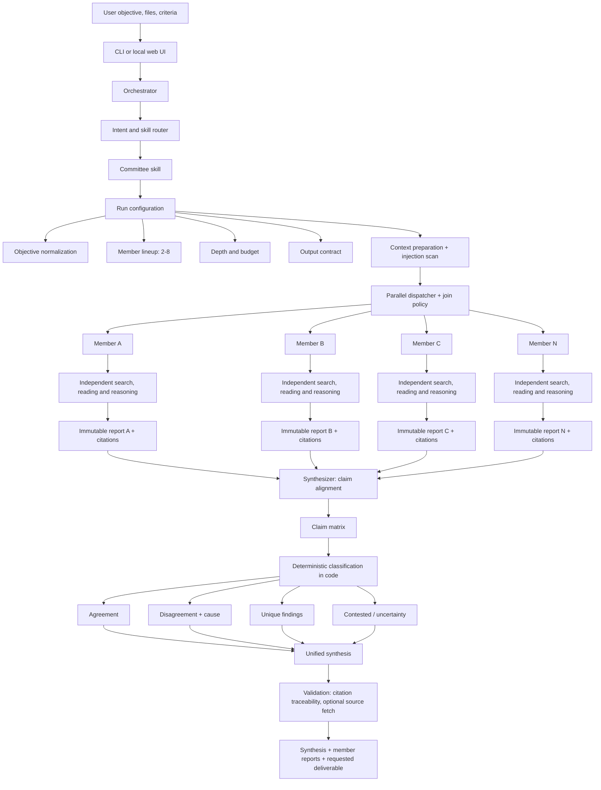

# Model Committee: Architecture

This document describes the architecture of Model Committee and maps each concept to the module that
implements it. The conceptual design is a de-branded reconstruction of how a commercial multi-model
council feature behaves, rebuilt here as an independent open implementation. Where this implementation
deliberately simplifies the reference design, the gap is called out in
[Gaps vs the reference architecture](#gaps-vs-the-reference-architecture).

## Executive summary

Model Committee is a **fan-out/fan-in agent workflow**. The orchestrator accepts one objective, builds a
run configuration, launches two to eight isolated model-research members, runs them independently and
concurrently, stores each full report as an immutable artifact, and passes those reports to a synthesizer
whose job is to identify agreement, disagreement (and its cause), unique findings and uncertainty. Output
skills then package the synthesis as an HTML report, a spreadsheet or a slide deck.

It is not "ask eight chatbots and take a vote." It is a **research ensemble plus a synthesis stage**.
Each member researches the question on its own (web search, reading sources, reasoning over supplied
context), so the synthesizer receives developed, cited reports rather than eight completions of a shared
prompt. The synthesizer does not vote: a 2-1 split is not "truth", and the minority report may hold the
only relevant source, clause or edge case.

The reliable core is:

```text
objective -> run configuration -> 2-8 concurrent independent research members -> immutable reports
          -> claim alignment -> deterministic agreement/disagreement/unique classification
          -> synthesis -> validation -> optional deliverable (report / spreadsheet / deck)
```

## System boundary

The committee runs inside an agent workspace: a general orchestrator that plans toward an outcome,
executes intermediate steps, uses web search, files and tools, and returns completed assets rather than
only a conversational answer. The committee itself is a skill, an executable methodology that activates
from the request, dispatches dedicated sub-agents in parallel and gathers their results. Other skills
(report, spreadsheet, deck) collaborate on the same task.

Logical containment hierarchy:

```text
Agent workspace (this machine)
└── Committee run  (runs/<run_id>/)
    ├── Orchestrator and run state        run-manifest.json, events.jsonl
    ├── Activated skill: model committee
    │   ├── Member A: frontier model + independent research loop
    │   ├── Member B: frontier model + independent research loop
    │   ├── Member C: frontier model + independent research loop
    │   └── ... up to eight members
    ├── Synthesizer / adjudicator
    ├── Evidence, citations and report artifacts
    └── Optional output skills
        ├── HTML research report
        ├── Spreadsheet (claim matrix + evidence)
        └── Slide deck
```

A sensible default committee is one frontier model from each of three vendors (Anthropic, OpenAI,
Google). The user can instead choose any two to eight members, including open-source and local models,
and select analysis depth from a brief run to a detailed report.

## Logical architecture



### Module map

| Stage | Module |
|---|---|
| Intent and skill router (deliverable/depth inference, skill registry) | `src/model_committee/router.py` |
| Run configuration | `src/model_committee/schemas.py` (`RunConfig`), `src/model_committee/depth.py` |
| Context preparation, text extraction, injection scanning | `src/model_committee/context.py` |
| Parallel dispatcher, join policy, retries, timeouts | `src/model_committee/orchestrator.py` |
| Member agent (prompt, parse structured findings) | `src/model_committee/member.py` |
| Sandboxes, immutable reports, manifest, sha256, `verify` | `src/model_committee/artifacts.py` |
| Provider data plane (CLIs, local, HTTP APIs) | `src/model_committee/providers/` |
| Claim alignment (model) + deterministic classification (code) | `src/model_committee/synthesis.py` |
| Citation traceability, optional source fetching | `src/model_committee/validation.py` |
| Output skills (HTML report, xlsx, pptx) | `src/model_committee/outputs/` |
| Interfaces | `src/model_committee/cli.py` (`committee`), `src/model_committee/server.py` + `static/` |

## End-to-end execution

### Intake and routing

A run begins when the user invokes the committee from the CLI (`committee run ...`) or the local web
UI. The router infers what was asked for (deliverable type, depth if not given) and activates the
committee skill plus any output skill the deliverable needs.

The orchestrator then assembles a run configuration. At minimum it contains the original objective,
supplied context, the two-to-eight member lineup, the requested depth and the desired output. In this
implementation that is `schemas.RunConfig`:

```json
{
  "objective": "Which supplier should we choose and why?",
  "models": ["claude-cli", "codex-cli", "agy:gemini-3.8-flash-high"],
  "synthesizer": "claude-cli",
  "depth": "detailed",
  "deliverable": "deck",
  "context_paths": ["supplier-a.pdf", "supplier-b.xlsx"],
  "criteria": ["cost", "implementation time", "lock-in"],
  "join": "all",
  "min_members": 2,
  "member_timeout_s": null,
  "retries": 1,
  "allow_web": true,
  "verify_sources": false
}
```

The member contract (state assumptions, cite evidence, report confidence, return a full report plus a
structured findings block) and the synthesis contract (agreement, disagreement and causes, unique
findings, recommendation) are encoded in the prompts and enforced by the `MemberFindings` and
`SynthesisNarrative` schemas rather than carried as flags.

### Context preparation

The user's prompt can be combined with supplied documents and with web information. Rather than stuffing
every possible source into one prompt, the orchestrator gives each member an authorised, bounded view of
context.

In this implementation `context.py` snapshots every supplied file into `runs/<run_id>/context/` with its
text extracted (PDF text via `pypdf`, plain text as-is), scans it for prompt-injection patterns, and
fences it as untrusted data inside each member prompt. Each member report records the context files it
actually received (`MemberReport.context_files`) so that context asymmetry is visible after the fact.

### Parallel independent branches

The same core objective is sent to every member concurrently, and each member researches it
independently. Independence matters: one member's draft never becomes another member's starting point,
which avoids direct anchoring and lets different search paths, assumptions and reasoning styles emerge.

Each member is logically a specialist research agent:

1. Interpret the objective, constraints and decision criteria.
2. Inspect the supplied context.
3. Search for external evidence where permitted (`allow_web`).
4. Read and evaluate sources.
5. Form conclusions and state assumptions.
6. Produce a self-contained report with citations, ending in a structured findings block (claims with
   confidence, evidence and assumptions; recommendation; counterargument; what would change its mind).
7. Persist the report as a separate, immutable artifact.

### Why branches differ

| Layer | Source of variation | What appears in the output |
|---|---|---|
| Model prior | Different training, alignment and reasoning behaviour | Different framing, risk tolerance or recommendations |
| Retrieval path | Different queries, sources and passages | Different evidence and unique findings |
| Assumptions | Different interpretation of missing facts | Disagreement despite compatible evidence |
| Tool strategy | Different order of search, file reading or calculation | Different depth and supporting analysis |
| Confidence | Different uncertainty calibration | One member says 60% where another says 95% |

Disagreements often come from different starting assumptions, which is why every member is required to
expose its assumptions and confidence. The other layers are ordinary consequences of independent agent
runs and are exactly why simple majority voting would throw away useful information.

### Artifact bundle

The fan-out stage terminates with a report bundle, not one mutable answer. Every member's full report is
kept as a separate file and the synthesis is the primary result. The run directory is:

```text
runs/<run_id>/
  run-manifest.json      config, member statuses + telemetry, sha256 of every artifact
  events.jsonl           progress events
  context/               snapshot of supplied context files (text extracted)
  sandboxes/<member>/    isolated working dir per member
  members/<member>.md    full member report (read-only)
  members/<member>.json  structured findings (read-only)
  raw/<member>.txt       raw provider output
  evidence-index.json    every cited source, by member and claim
  claim-matrix.json      canonical claims, stances, deterministic classification
  synthesis.md / synthesis.json
  validation.json
  report.html / committee.xlsx / committee-deck.pptx   (per deliverable)
```

All writes go through `artifacts.RunStore`, so the manifest always lists every file with its sha256.
Member reports are written read-only and flagged `immutable`; `committee verify runs/<run_id>`
(`artifacts.verify_run`) re-hashes every artifact and reports anything missing, modified, or an
immutable file that has become writable.

### Synthesis and adjudication

A synthesizer model reads every member output and produces one combined answer organised around:

- where the members agree;
- where they disagree, and why;
- what only one member surfaced;
- the resulting decision or recommendation, if the objective asks for one.

Merging reports by prose similarity is not safe. The synthesis has to compare **claims**: their polarity,
assumptions, evidence and confidence. The committee builds an explicit claim matrix:

| Claim | Member A | Member B | Member C | Evidence status | Classification |
|---|---|---|---|---|---|
| Supplier A is cheaper over three years | Support | Support | Support | Same spreadsheet cells | Agreement |
| Supplier B can deploy inside 12 months | Reject | Support | Uncertain | Different implementation assumptions | Disagreement |
| Supplier A has a change-of-control risk | Not mentioned | Not mentioned | Support | Contract clause 14 | Unique finding |

In this implementation the work is split in two:

1. **Alignment (model).** The synthesizer maps each member's claims onto canonical claims and records a
   per-member stance (`support`, `reject`, `uncertain`, `not_mentioned`) with references back to the
   member claim ids, plus a disagreement type and cause where relevant (`CanonicalClaim`).
2. **Classification (code).** `synthesis.classify()` computes the classification from the stances, never
   from the model's prose:
   - `agreement`: two or more members support and nobody rejects;
   - `disagreement`: at least one support and one reject;
   - `unique`: only one member raised the claim;
   - `contested`: raised by two or more members but nobody firmly supports it.

   It also fills the support/reject/uncertain counts, `model_consensus`, `independent_sources` and
   `source_domains` for every claim.

The synthesizer then writes the narrative (`SynthesisNarrative`: headline, answer, recommendation,
confidence note, decision matrix against the user's criteria, unresolved risks, next actions, citations).
The agreement, disagreement and unique sections of `synthesis.md` are rendered from the matrix, not from
the narrative, so a polished majority story cannot silently drop a minority finding.

### Evidence handling: attribution vs grounding

There are two separate evidence questions:

- **Attribution:** which member made a claim?
- **Grounding:** which source actually supports it?

Attribution is preserved structurally: every canonical claim carries `<member_key>/<claim_id>` references,
and `evidence-index.json` lists every cited source by member and claim. Grounding is weaker by nature.
"Three members agree" is **model consensus**, not three independent primary sources. If every member
leans on the same wrong article, the committee can reach unanimous but correlated error. Ensembling
increases perspective diversity; it does not guarantee factual correctness. That is why the claim matrix
reports independent source domains next to the member count, and why validation checks that every
citation in the synthesis traces back to a member.

### Deliverable generation

After synthesis, output skills package the result as a work-ready asset. The committee skill supplies the
decision analysis; the output skill supplies the production methodology. A deck request becomes:

```text
committee synthesis
-> extract decision narrative
-> construct slide outline
-> build tables from the claim matrix and decision matrix
-> render deck
-> register artifact in the manifest (sha256)
-> return synthesis + member reports + deck
```

Available deliverables (`schemas.Deliverable`): `none` (synthesis and member reports only), `report`
(standalone HTML), `spreadsheet` (xlsx claim matrix and evidence), `deck` (pptx), `all`.

## Control plane and data plane

### Control plane

The control plane coordinates work without doing the reasoning itself:

- Activate the committee skill and any output skill.
- Resolve provider availability for the selected lineup (`Provider.available()`, `committee providers`).
- Allocate depth: time budget, report length, source and claim limits (`depth.py`).
- Launch, monitor, retry, time out or cancel members (`orchestrator.py`).
- Maintain run state and artifact references (`run-manifest.json`, `events.jsonl`).
- Invoke synthesis only once the join policy is satisfied.
- Route the synthesis into output skills.

Every additional member is a full agent run with its own research, so cost scales with committee size and
depth. Provider telemetry (duration, tokens, cost where the backend reports it, web searches, tool calls,
exit code) is recorded per member in the manifest.

### Data plane

The data plane does the actual work:

- Frontier and open-source model inference.
- Web search and page retrieval inside each member's agent loop.
- Context file parsing.
- Report and asset generation.
- Evidence and artifact storage.

A member is more than a hosted model call: when it runs on an agent CLI, it is an agent loop alternating
reasoning with searches and file reads. All backends sit behind one interface, `providers.base.Provider`
(`generate(prompt, workdir, timeout_s, research)` and `available()`).

## Execution isolation

The reference design runs each task in a dedicated microVM with its own kernel, isolated filesystem and
private network namespace; credentials are scoped to the task, raw API keys are never handed to
sub-agents, and external content is scanned by classifiers that can stop the workflow.

Conceptually the security flow is:

```text
Member agent in isolated sandbox
        │
        ├── web traffic      -> read-only search / fetch tools only
        ├── context files    -> fenced, pre-scanned snapshot in runs/<run_id>/context/
        ├── filesystem       -> its own working dir runs/<run_id>/sandboxes/<member>/
        └── model call       -> orchestrator-managed provider adapter
```

This implementation gives each member its own sandbox working directory as cwd and runs agent CLIs with
read-only tool permissions (web search, web fetch, read): no write, edit or shell-execution tools. The
synthesizer runs with `research=False`, meaning no tools at all, only reasoning over supplied text. API
keys are read from the environment by the HTTP adapters and never placed in prompts. See the gaps section
for how this differs from VM-level isolation.

## Concurrency and join policies

The committee's main performance advantage is parallelism. With member run times `t1 ... tn`, wall-clock
latency tracks the slowest member, not the sum:

```text
T_committee ≈ T_setup + max(t1, t2, ..., tn) + T_synthesis + T_render
```

This is an explanatory model. Real latency also includes rate limits, retries, source retrieval and
output rendering.

The orchestrator needs a join policy before synthesis (`schemas.JoinPolicy`):

| Policy | Behaviour |
|---|---|
| `all` (default) | Wait for every member to finish, fail or time out. Fail the run if fewer than `min_members` succeed. |
| `quorum` | Synthesize as soon as `min_members` have succeeded and the rest are done or timed out. Members cancelled after quorum are recorded as `skipped`. |

Each member gets `retries` additional attempts on failure (default 1) and a hard wall-clock timeout
(`member_timeout_s`, defaulting to the depth budget). Statuses are `pending`, `running`, `succeeded`,
`failed`, `timed_out` and `skipped`; missing members are listed in the synthesis (`members_missing`) so a
degraded run is visible rather than silent.

Member reports are immutable; only the synthesis and output stages create derived artifacts, so no
branch can overwrite another.

## Depth

Depth governs a set of budget levers (`depth.BUDGETS`):

| Lever | Brief | Standard | Detailed |
|---|---|---|---|
| Member report length (words) | ~350 | ~900 | ~1800 |
| Max sources per member | 3 | 6 | 12 |
| Max claims per member | 5 | 8 | 12 |
| Member timeout | 420 s | 900 s | 1800 s |
| Synthesis timeout | 420 s | 600 s | 900 s |
| Search guidance | A few targeted searches; only the most authoritative sources | Several angles; read primary sources before concluding | Multiple query formulations, primary sources, at least one deliberate search for disconfirming evidence; cross-check every quantitative claim |
| Synthesis granularity | Main findings | Claim- and assumption-level | Claim-, assumption- and evidence-level |

## What agreement means

Committee agreement is evidence that several model-agent pipelines independently reached compatible
conclusions. It is a useful robustness signal, especially when members come from different model
families and retrieve evidence independently.

It is **not** a calibrated probability that the claim is true. Members may share training data, retrieve
the same sources, inherit the same flawed premise from the user, or converge on a plausible but wrong
explanation. A high-stakes workflow should keep these separate:

| Signal | Meaning | Where it lives |
|---|---|---|
| Model consensus | How many member reports support the claim | `CanonicalClaim.support`, `model_consensus` |
| Source independence | How many genuinely independent sources support it | `independent_sources`, `source_domains` (distinct cited domains) |
| Evidence quality | Whether those sources directly establish the claim | `Evidence.quote`, optional fetch + quote check in `validation.json` |
| Assumption sensitivity | Whether changing an assumption changes the decision | `MemberClaim.assumptions`, disagreement type `assumption` |
| Confidence | How certain each member says it is, with justification | `MemberClaim.confidence`, `would_change_mind` |

Convergence is a reason for more confidence; disagreement is a signal to investigate. Neither is a proof.

## Disagreement taxonomy

The synthesizer must preserve the cause of a disagreement rather than flattening it into "models
differed." Each disagreement is tagged with a `DisagreementType`, and the recommended handling is
attached from `schemas.DISAGREEMENT_HANDLING`:

| Type | Diagnostic | Recommended handling |
|---|---|---|
| Factual | Members assert incompatible facts | Return to primary sources and verify dates, definitions and versions |
| Assumption | Same facts, different unstated premises | Expose the assumptions and rerun the scenarios |
| Forecast | Different expectations about uncertain events | Give ranges, drivers and leading indicators |
| Value | Different priorities or risk tolerance | Ask the decision-maker to set weights or decision criteria |
| Scope | Members answer subtly different questions | Normalize the objective and rerun the affected branches |
| Evidence | Members found different sources | Compare source quality and independence |
| Calculation | Same inputs, different result | Recompute deterministically in code or a spreadsheet |

## Failure modes

### Correlated consensus

Different vendors do not guarantee independent knowledge. Members share public training corpora,
conventions and dominant web sources. Mitigation: the claim matrix reports independent source domains
next to model consensus, so "three members, one source" is visible.

### Synthesizer bottleneck

The final narrative is still written by one model, which can omit a minority finding, misclassify
nuanced positions or compress away caveats. Mitigation: classification is computed in code from
stances; agreement, disagreement and unique sections are rendered from the matrix; validation checks
`unique_findings_preserved`; every member report remains available and hash-verified.

### Context asymmetry

If one member cannot read a file or source that another can, apparent disagreement may be a tooling
difference. Mitigation: each member report records the context it received, and telemetry records web
searches and tool calls per member.

### Citation laundering

A synthesis can repeat a claim with a citation inherited from a member without checking that the cited
passage supports it. Mitigation: `validation.py` flags any synthesis URL that no member cited
(`untraceable_citations`), and `--verify-sources` fetches cited URLs and checks whether the quoted
passage is present. For material decisions, still read the cited source and the member report.

### Prompt injection and untrusted content

Research agents read external pages and files that may contain embedded instructions. Mitigation:
supplied context is pre-scanned for injection patterns and fenced as data; members have read-only tools,
so an injected instruction cannot write files or run commands; member output is treated as untrusted by
the synthesizer and the output skills. No automated defence removes all risk.

### Cost and latency growth

Each added member performs its own research, so cost grows with committee size and depth. Parallelism
cuts wall-clock time but not total inference, retrieval and tool workload. A detailed run with eight
members is expensive.

### False precision

Self-reported confidence such as "85%" is useful for comparison but is not statistically calibrated.
The most useful confidence explanation includes assumptions, the strongest counterargument and what
evidence would change the conclusion, all of which the member contract requires.

## Orchestrator pseudocode

```python
async def run_committee(request):
    config = normalize_request(request)                 # router.py -> RunConfig
    store = RunStore(runs_dir, RunManifest(run_id=..., config=config))
    context = prepare_context(config.context_paths, store)   # snapshot, extract, scan, fence
    budget = budget_for(config.depth)

    async def run_member(spec):
        provider = resolve_provider(spec)
        sandbox = store.sandbox(member_key)              # isolated cwd
        for attempt in range(1 + config.retries):
            result = await provider.generate(
                member_prompt(config, context, budget),
                workdir=sandbox,
                timeout_s=config.member_timeout_s or budget.member_timeout_s,
                research=config.allow_web,                # read-only tools only
            )
            findings = parse_findings(result.text)       # MemberFindings
            if findings:
                break
        return persist_immutable_report(store, member_key, result, findings)

    reports = await gather_with_policy(
        [run_member(spec) for spec in config.models],
        join=config.join,
        minimum=config.min_members,
    )

    matrix = await align_claims(config.synthesizer, reports)   # model: canonical claims + stances
    matrix = classify(matrix, reports)                          # code: agreement/disagreement/unique
    synthesis = await write_narrative(config.synthesizer, config, matrix, reports)
    validation = validate(synthesis, reports, fetch=config.verify_sources)
    assets = render_outputs(synthesis, validation, config.deliverable, store)
    return store.finish(synthesis, validation, assets)
```

## Recommended run design

For a consequential supplier, architecture, product or investment decision, give the committee an
explicit analytical contract:

```text
Run a model committee with one leading model from Anthropic, OpenAI and Google.
Use detailed depth.

Decision: [state the exact decision]
Context: [attach files and list constraints]
Criteria: [cost, capability, implementation time, security, lock-in]
Time horizon: [period]

Require each member to:
1. Research independently.
2. State assumptions and missing information.
3. Cite primary sources where possible.
4. Give a recommendation, confidence level and strongest counterargument.
5. Identify what evidence would change its recommendation.

In the synthesis:
- Separate factual, assumption-based and values-based disagreements.
- Show unique findings even if only one member found them.
- Distinguish model consensus from independent source support.
- Recalculate quantitative claims deterministically.
- End with a decision matrix, unresolved risks and next verification actions.

Return the synthesis, every member report, and a board-ready deck.
```

With the CLI, items 1-5 are built into every member prompt, the criteria map to `--criteria`, the
attachments to `--context`, and the deck to `--deliverable deck`. Ask pointed decision questions with
numbers, timelines and trade-offs; vague objectives produce vague committees.

## Design decisions in this implementation

- **Classification is deterministic.** The synthesizer model only aligns member claims into canonical
  claims with per-member stances. Agreement, disagreement, unique and contested are computed in code
  (`synthesis.classify()`), so the narrative cannot silently drop or relabel a minority finding.
- **Model consensus is reported separately from source independence.** Every canonical claim carries both
  the member support count and the number of distinct cited source domains.
- **Member reports are immutable.** Written once, set read-only, sha256-recorded in the manifest, and
  re-checkable with `committee verify <run>`.
- **Members are isolated.** Each runs in its own sandbox working directory with read-only tools (search,
  fetch, read); no write, edit or exec tools. The synthesizer runs with no tools.
- **Context received is recorded per member.** `MemberReport.context_files` lists exactly what each branch
  saw, making context asymmetry auditable.
- **Join policies: `all` and `quorum`.** With `min_members` (default 2), per-member retries (default 1) and
  hard per-member timeouts from the depth budget.
- **Depth budgets are explicit.** Report length, source and claim limits, timeouts, search guidance and
  synthesis granularity are fixed per depth in `depth.py`, not left to the model.
- **Citation traceability is validated.** Every URL in the synthesis must trace to at least one member;
  optional source fetching (`--verify-sources`) records HTTP status and whether the quoted passage was
  found.
- **Providers span vendors and access modes.**
  - `claude-cli`: Anthropic models via the Claude Code CLI.
  - `codex-cli`: OpenAI models via the Codex CLI.
  - `agy`: the Antigravity CLI, used for Google Gemini models and the open-source GPT-OSS model (it also
    exposes a Claude model).
  - `ollama`: local open-weight models.
  - `openai`, `anthropic`, `google`, `openrouter`: HTTP API adapters, enabled only when the matching API
    key is present in the environment.
- **Untrusted content is fenced.** Context is pre-scanned for injection patterns; member output is treated
  as data by the synthesizer, the output skills and the web UI.

## Gaps vs the reference architecture

This implementation is simpler than the ideal design in several places. These are honest limits, not
roadmap promises.

- **Sandboxes are directories, not VMs.** Isolation is a per-member working directory plus restricted tool
  permissions enforced by each agent CLI. There is no microVM, separate kernel or private network
  namespace; a member process runs as the local user. Isolation is only as strong as the CLI's tool
  permission model.
- **Injection defence is pattern-based.** Context is scanned with heuristics, not a trained classifier, and
  web pages a member reads during its own research are not intercepted by the orchestrator.
- **No connector integrations.** Members see the web and the files passed with `--context`. There is no
  email, chat, issue tracker, warehouse or CRM access, and no shared persistent project workspace.
- **No deterministic recalculation of quantitative claims.** Calculation disagreements are tagged and the
  recommended handling ("recompute deterministically") is surfaced, but the committee does not execute the
  recomputation itself.
- **Grounding checks are shallow.** Source fetching checks that a URL resolves and that the quoted passage
  appears in the page text. It does not verify that the passage entails the claim.
- **Self-reported confidence is not calibrated.** Confidence values are passed through and compared, never
  adjusted.
- **No separate critic pass.** Validation is rule-based; there is no second model reviewing the synthesis
  before delivery.
- **Long reports are not ranked or truncated intelligently.** Depth budgets bound report size up front
  instead of the synthesizer selecting what to read.
- **No credit or entitlement layer.** Cost is whatever each provider charges the logged-in user; telemetry
  records it where the backend reports it.
